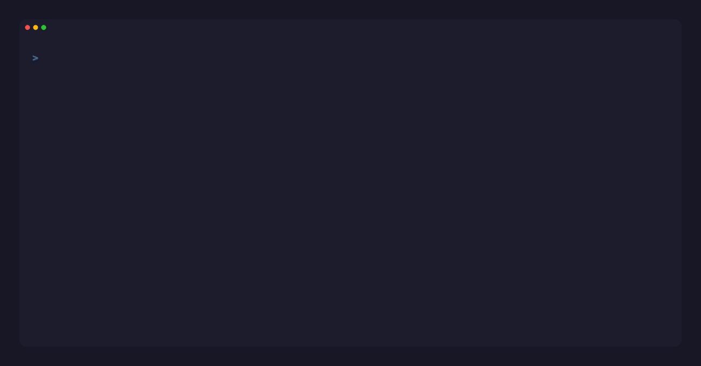

# Delegate skill for Claude Code

A [Claude Code](https://claude.com/claude-code) skill that runs a task on a subagent and returns only the result to your session. Write "delegate" in a message, or ask for something to run on a subagent. Claude picks a model, writes the subagent a brief and reports back what it found.



_A staged illustration made with `demo/delegate.sh`, not a recording of a real session._

## Why

Everything Claude reads in a session stays in its context, including whole files opened to find one function and full test logs. Later turns cost more, and older details get pushed out. A subagent does that reading in its own context and sends back a short report, usually from a cheaper model than the one you are talking to.

I kept typing "run this on a subagent and pick a suitable model". With this skill, "delegate" is enough.

## Examples

| You write | What happens |
| --- | --- |
| `review this plan, delegate` | One subagent reviews the plan and you get its findings |
| `fix 1 and 2, delegate` | Each item gets its own subagent, and they run in parallel |
| `look at this as a Payload developer, on opus` | The subagent runs on the model you named |
| `run the tests in a subagent` | Plain language works too, without the word "delegate" |

## Install

With the [skills](https://skills.sh) installer, for all your projects:

```bash
npx skills add FilipMessa/claude-code-delegate-skill -g -a claude-code
```

Leave out `-g` to install it into the current project only. Start a new Claude Code session afterwards, because skills are discovered when a session starts.

Update it with:

```bash
npx skills update delegate -g
```

### Manually

Clone the repository and link the skill into your personal skills folder:

```bash
git clone https://github.com/FilipMessa/claude-code-delegate-skill.git ~/claude-code-delegate-skill
mkdir -p ~/.claude/skills
ln -s ~/claude-code-delegate-skill/skills/delegate ~/.claude/skills/delegate
```

If a `delegate` skill already exists in `~/.claude/skills`, inspect it before replacing it. To update, run `git pull` in the clone.

## How it works

1. The subagent starts with none of your conversation, so Claude writes it a brief that works on its own. The brief covers the goal, decisions already made, the files and issues involved, the session's rules (worktrees, commit and push rules, skills to load), when the task counts as done, and how to report. For a code change, done means the change with the narrowest checks for the touched files passing; review, the full checks and the pull request are left out of the brief. If the brief would mostly repeat the conversation, Claude forks the session instead.
2. If you named a model, Claude uses it. Otherwise it picks the cheapest model and effort it expects to do the job. A task that takes several rounds of trial and error, such as debugging, goes to a single subagent that keeps going until it has an answer.
3. Before the subagents start, Claude tells you in one line each what they will do, on which model and effort, and why.
4. When a subagent finishes, Claude checks its report against the brief and reads screenshots and the final diff before a commit itself. A poor report goes back to the same subagent, or once to a stronger model. A code change is reviewed as soon as its subagent returns, and the project's full checks then run once, on the final commit, before the pull request. You get the answer, where to find the evidence, and anything still open.

Independent items run in parallel. Subagents that change files each work in their own git worktree.

## Trade-offs

- Each subagent starts by reading the project's instructions again. On a small task that can cost more tokens in total than working in the main session, so delegating pays off when there is a lot to read.
- You see nothing until the subagent finishes.
- The skill's one-sentence description is loaded in every session, so that the word "delegate" can trigger it.

## Requirements

Claude Code with subagents (the Agent tool). The skill uses Claude Code's agent types, forks and `SendMessage`, so other coding agents can't run it as written.

## Uninstall

```bash
npx skills remove delegate -g
```

For a manual install, delete the link instead: `rm ~/.claude/skills/delegate`.

## License

MIT
